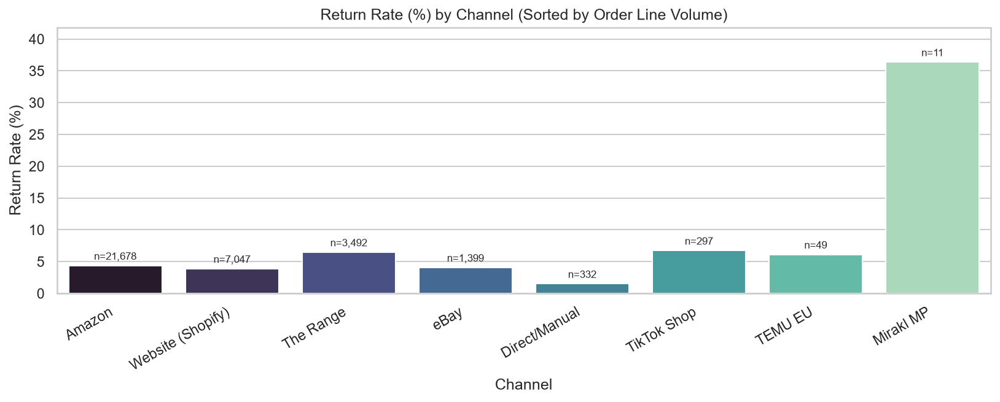
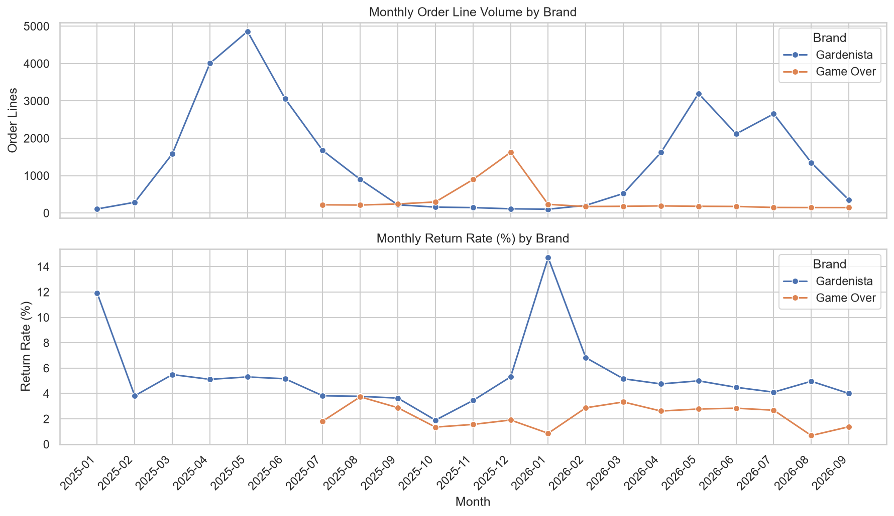
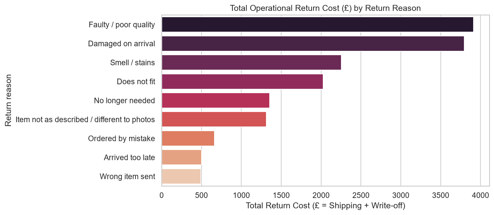
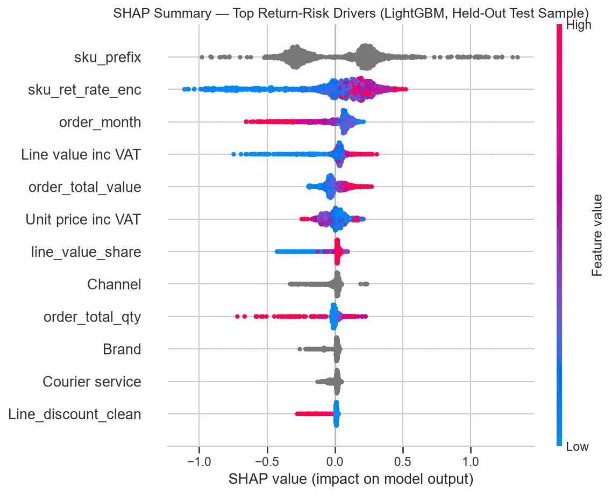
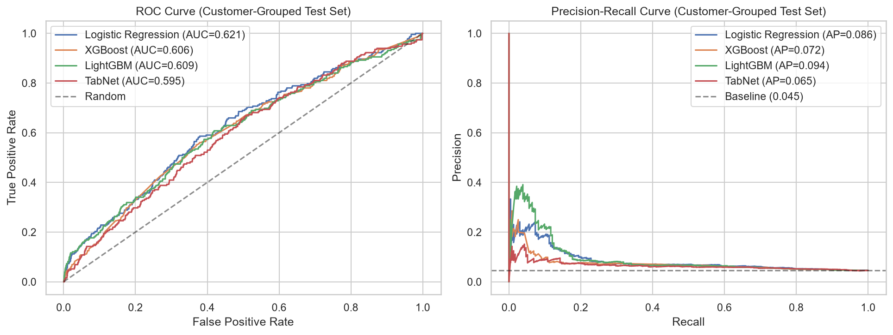
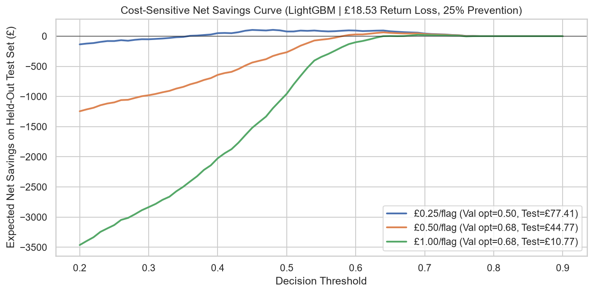
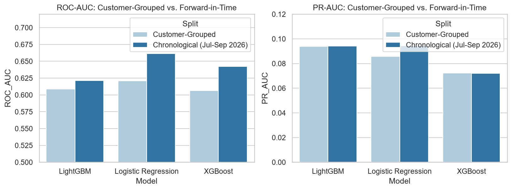
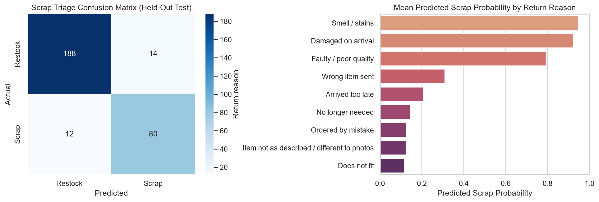

# Loft25 Customer Returns — Modular Analysis & Predictive Modeling

[](https://colab.research.google.com/github/promit-bhattacharjee/loft25-returns-analysis/blob/main/Loft25_Returns_Analysis_Modular.ipynb)

End-to-end data quality audit, exploratory data analysis (EDA), SHAP explainability, cost-sensitive ROI thresholding, forward-in-time validation, and return scrap-risk triage for **Loft25** (*Gardenista* & *Game Over* brands) across 21 months of e-commerce data (`2025-01-05` to `2026-09-30`).

---

## Repository Structure

```text
loft25-returns-analysis/
├── Loft25_Returns_Analysis_Modular.ipynb     # Executed 9-module notebook (136 cells: 98 text, 38 code)
├── requirements.txt                          # Pinned minimum dependencies
├── README.md                                 # Project summary, metrics & embedded visuals
├── figures/                                  # 10 exported high-DPI PNG charts (01–10)
├── reports/
│   └── Loft25_Returns_Analysis_Report.html   # Standalone HTML report exported via nbconvert
├── archive/
│   └── Untitled0.ipynb                       # Original exploratory draft (archived)
├── Loft25_BCU_04_P4_order_lines.csv          # 34,305 × 15 order-line transactions
├── Loft25_BCU_05_P4_returns_by_SKU.csv       # 1,458 × 10 SKU return aggregates
├── Project 4 & 5 - customer orders.xlsx      # 31,410 × 6 customer order registry
└── Project 4 & 5 - Returns.xlsx              # 1,523 × 20 return reasons, costs & scrap status
```

---

## Operational & Financial KPIs

| Metric | Value |
| :--- | :--- |
| Total Order Lines / Distinct Orders / Customers | 34,305 / 31,410 / 22,854 |
| Line / Order / Unit Return Rate | 4.47% / 4.59% / 4.83% |
| Gross Sales Value (inc VAT) | £1,622,434.24 |
| Total Refunded Value | £79,405.56 |
| Direct Operational Return Cost (`Shipping + Write-off`) | £16,317.26 |
| Return Scrap Rate | 29.61% (451 / 1,523 returns) |

### Audited Data Quality Findings
1. **Blank Excel column:** `Returns.xlsx` column O (`Unnamed: 14`) is 100% empty (dropped in `2.2`).
2. **10 £0-value returns missing from `Returns.xlsx` (1,533 vs. 1,523):** All 10 have `Unit price = 0, Refund = 0` (`Direct/Manual`: 5, `TikTok Shop`: 5). Separately, 5 `TikTok Shop` rows inside `Returns.xlsx` refunded £0 despite non-zero line prices (£18.98–£71.88).
3. **Discount outliers:** `Line discount` is percentage-like and reaches `200` on 3 two-unit £0 rows (`Qty = 2`); clipped to `[0, 100]`.
4. **Zero-price order lines:** 724 lines have `Unit price inc VAT == 0` (327/332 of `Direct/Manual`).
5. **Composite join key:** `('Order ref', 'SKU')` is unique in both `order_lines` and `Returns.xlsx` (joining on `'Order ref'` alone causes row duplication since 1,523 return lines span 1,433 orders).

---

## Visual Highlights

| Brand & Channel Return Rates | Monthly Seasonality by Brand |
| :---: | :---: |
|  |  |

| Operational Return Cost by Reason | SHAP Global Feature Drivers (LightGBM) |
| :---: | :---: |
|  |  |

---

## Modular Notebook Architecture (`Loft25_Returns_Analysis_Modular.ipynb`)

Every sub-step strictly follows **Title `[text]` → Explanation `[text]` → Small Code Block `[code]`**:

- **Module 1 (`1.1`–`1.4`)** — Setup, auto-path detection (local `.` vs. Colab `/content`), `figures/` export setup, data loading
- **Module 2 (`2.1`–`2.4`)** — Null/duplicate audit, column/date cleaning, cross-table key checks, discount clipping
- **Module 3 (`3.1`–`3.2`)** — Pre-purchase `master_df` join (`Order ref`) & EDA-only composite-key join (`['Order ref', 'SKU']`)
- **Module 4 (`4.1`–`4.7`)** — KPIs, Brand/Channel/Monthly/Courier/Return-Reason/SKU EDA with 5 saved PNG charts
- **Module 5 (`5.1`–`5.6`)** — Checkout-time features, past-only customer order history, customer-grouped 70/15/15 split, 5-fold customer-grouped OOF smoothed SKU target encoding, native-categorical & embedding-safe preprocessors
- **Module 6 (`6.1`–`6.5`)** — Imbalance-aware training: Balanced Logistic Regression, Tuned Native-Categorical XGBoost, Balanced LightGBM, and TabNet (all tuned strictly on validation)
- **Module 7 (`7.1`–`7.4`)** — Leaderboard, ROC/PR curves, TreeSHAP explainability, and multi-tier cost-sensitive £ ROI curve
- **Module 8 (`8.1`–`8.3`)** — Forward-in-time chronological validation (`2025-01`–`2026-04` train → `2026-05`–`06` val → `2026-07`–`09` test)
- **Module 9 (`9.1`–`9.4`)** — Return scrap-risk triage classifier (`Returns.xlsx`) and business recommendations

---

## Modeling Results

### 1. Customer-Grouped Held-Out Test Set (`n = 5,109`, `3,429` unseen customers, `4.54%` baseline)

| Model | Val Threshold | ROC-AUC | PR-AUC | Precision (1) | Recall (1) | F1 (1) |
| :--- | :---: | :---: | :---: | :---: | :---: | :---: |
| **LightGBM (Native Cat + Balanced)** | 0.5781 | 0.6088 | **0.0938** | **0.1034** | 0.1681 | 0.1281 |
| **Logistic Regression (Balanced)** | 0.6285 | **0.6208** | 0.0858 | 0.0904 | **0.2284** | **0.1296** |
| **XGBoost (Native Cat + Tuned)** | 0.5269 | 0.6063 | 0.0724 | 0.0988 | 0.1078 | 0.1031 |
| **TabNet (Embeddings + Balanced)** | 0.6106 | 0.5947 | 0.0654 | 0.0751 | 0.1940 | 0.1083 |

### 2. Cost-Sensitive Thresholding (LightGBM on Held-Out Test Set)
Calibrated to `£18.53` avoided loss per prevented return (`£10.71` direct return cost + `15%` handling friction on `£52.14` avg refund) assuming `25%` prevention rate on flagged true returns:

| Intervention Tier | Cost / Flag | Break-Even Precision | Val-Optimal Cutoff | Test Flagged | Test True Returns (Precision) | Realized Test Net Savings |
| :--- | :---: | :---: | :---: | :---: | :---: | :---: |
| Automated fit/sizing email | £0.25 | 5.4% | 0.50 | 1,377 | 91 (6.6%) | **+£77.41** |
| Guided SMS / pre-dispatch check | £0.50 | 10.8% | 0.68 | 68 | 17 (**25.0%**) | **+£44.77** |
| Manual warehouse QA check | £1.00 | 21.6% | 0.68 | 68 | 17 (**25.0%**) | **+£10.77** |

### 3. Forward-in-Time Validation (`Jul–Sep 2026`, `n = 4,793`, `4.11%` baseline)

| Model | ROC-AUC (Grouped → Temporal) | PR-AUC (Grouped → Temporal) | Temporal Precision (1) | Temporal F1 (1) |
| :--- | :---: | :---: | :---: | :---: |
| **Logistic Regression** | 0.6208 → **0.6612** | 0.0858 → **0.0943** | 0.0929 | 0.1254 |
| **LightGBM** | 0.6088 → **0.6212** | 0.0938 → **0.0942** | **0.1522** | 0.1254 |
| **XGBoost** | 0.6063 → **0.6425** | 0.0724 → **0.0720** | 0.1056 | **0.1310** |

### 4. Return Scrap-Risk Triage Classifier (`Returns.xlsx`, unseen customers, `n = 294`)
Predicts whether a logged return will be scrapped vs. restocked (`29.6%` overall scrap rate):
- **Test ROC-AUC:** `0.9281` | **PR-AUC:** `0.8882` | **Accuracy:** `91%`
- **Scrapped Class:** Precision `0.85`, Recall `0.87`, F1 `0.86`

| ROC / PR Curves | Cost-Sensitive ROI Curve |
| :---: | :---: |
|  |  |

| Split Generalization Stability | Scrap Triage Confusion Matrix & Drivers |
| :---: | :---: |
|  |  |

---

## Quick Start

### Option 1: Google Colab (1-Click)
Click the **Open in Colab** badge at the top, upload the 4 dataset files to `/content/`, and run all cells (Module `1.1` installs missing packages automatically).

### Option 2: Run Locally
```bash
git clone https://github.com/promit-bhattacharjee/loft25-returns-analysis.git
cd loft25-returns-analysis
pip install -r requirements.txt
jupyter notebook Loft25_Returns_Analysis_Modular.ipynb
```

Or open the pre-rendered standalone report directly in any browser:
- `reports/Loft25_Returns_Analysis_Report.html`
